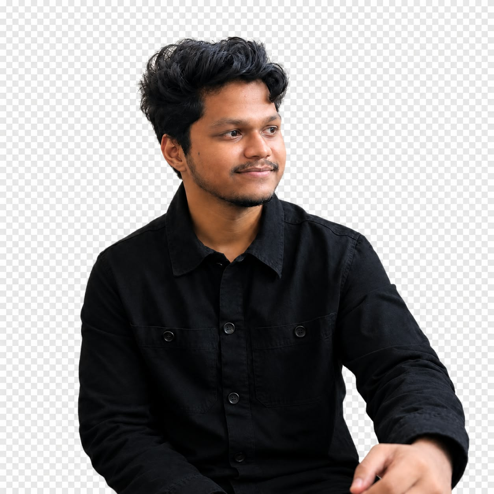
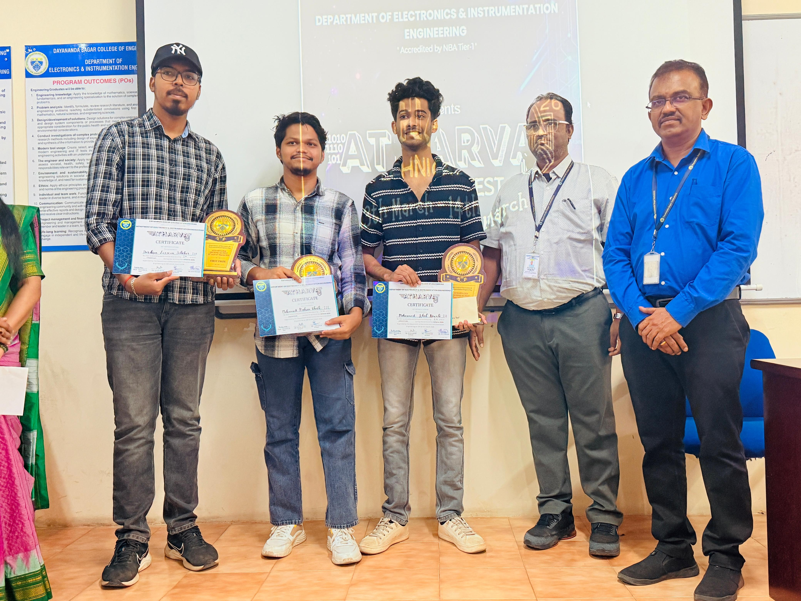
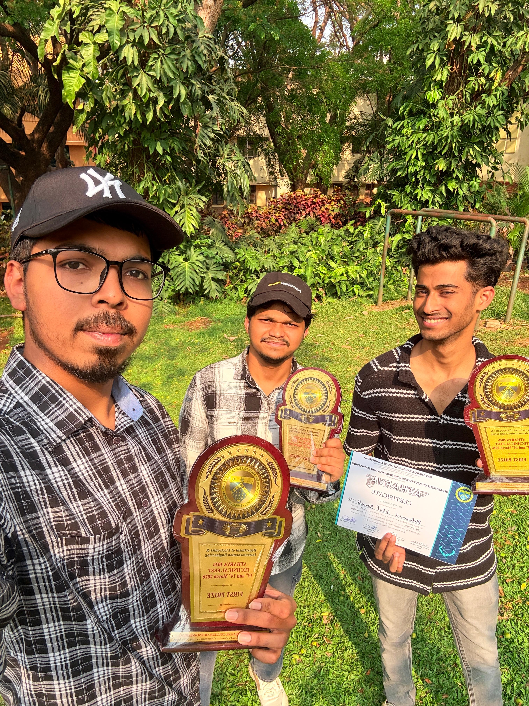
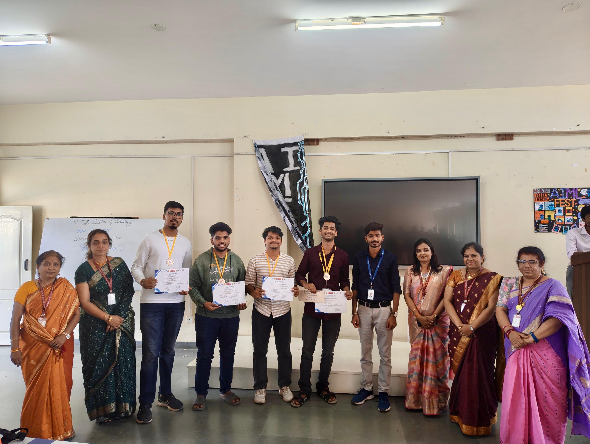
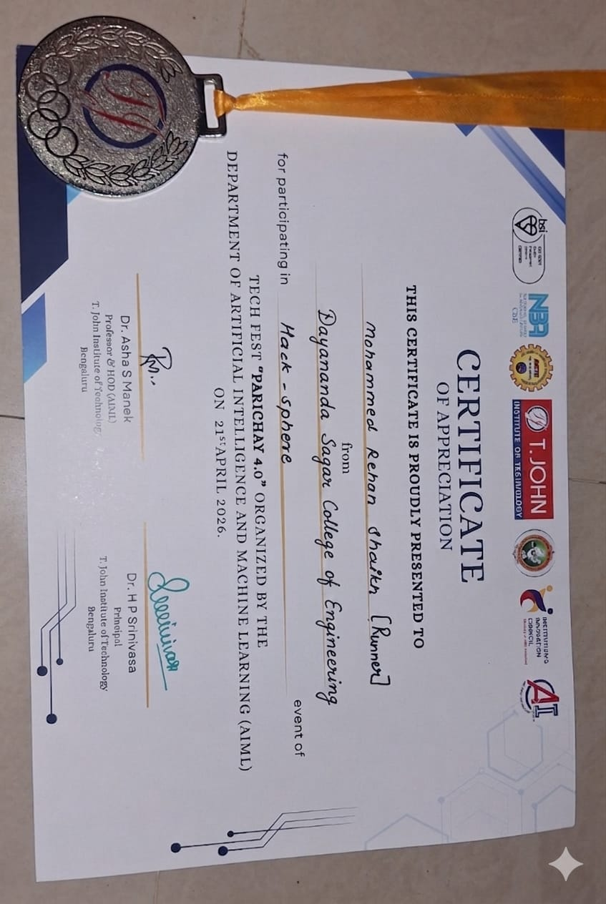
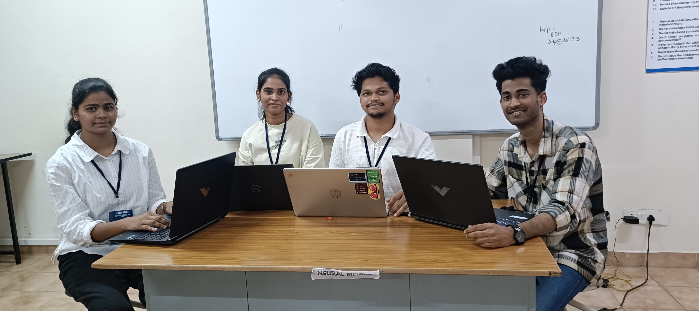
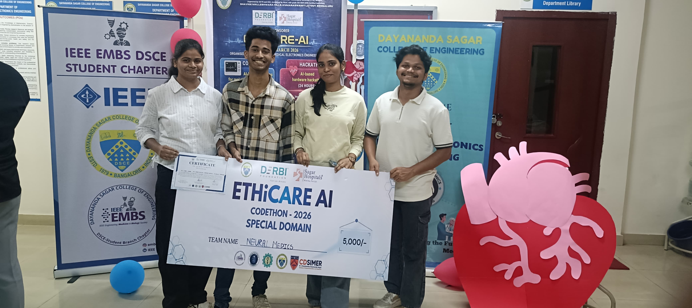

<div align="center">

  

  <h1>Mohammed Rehan Shaikh</h1>
  <p><strong>Software Engineer • Backend & Full-Stack Developer • ML & Computer Vision</strong></p>
  <p>📍 Bengaluru, Karnataka, India • 🎓 Dayananda Sagar College of Engineering (CGPA 8.72 / 10)</p>

  <p>
    <a href="mailto:rs2425071@gmail.com"></a>
    <a href="https://www.linkedin.com/in/rehan-shaikh-47403229b" target="_blank"></a>
    <a href="https://github.com/Rehan0813" target="_blank"></a>
  </p>

  <p>
    
    
    
    
  </p>

</div>

---

## 👨‍💻 About Me

I am a Computer Science & Engineering student at **Dayananda Sagar College of Engineering (CGPA 8.72)** with strong hands-on software development experience across production backends, machine learning pipelines, and competitive hackathons.

- ⚡ **Backend & Distributed Systems**: Building robust, asynchronous REST APIs in **Python** and **FastAPI**, with **PostgreSQL**, **MongoDB**, and **MySQL**, fully containerized with **Docker**.
- 🤖 **Applied AI & Computer Vision**: Developing real-time inference workflows using **YOLOv8**, **OpenCV**, **MediaPipe**, **MobileNetV2**, **LSTM**, and **Gemini API**.
- 🏆 **Proven Track Record**: 3 podium finishes across high-intensity collegiate and industry hackathons.

---

## 🏆 Hackathon Victories & Recognitions

### 🥇 1st Place Winner — Atharva Hackathon
- **Institution**: Dayananda Sagar College of Engineering (DSCE)
- **Project**: **Adaptive Cache Management Engine**
- **Description**: Engineered an intelligent cache replacement engine using a **Random Forest** model that predicts optimal cache policies (**LRU, LFU, FIFO**) from access frequency, reuse distance, and temporal/spatial locality with a live React telemetry dashboard.
- **Proof & Photos**: [📜 Official Award Announcement & Verification](https://lnkd.in/p/gKsNgAXd)

<div align="center">
  
  
</div>

---

### 🥈 2nd Prize Winner — TechFest Parichay 4.0
- **Institution**: Dept. of AI & ML, T. John Institute of Technology (TJIT)
- **Project**: **SmartFlow AI — Adaptive Traffic Signal System**
- **Description**: Replaced static fixed-timer signals with real-time computer vision control. Detects vehicles using **YOLOv8 & OpenCV** and calculates dynamic green-signal timings (15–60s) served via FastAPI.
- **Team**: Mohammed Rehan Shaikh, Iqbal Nawab, Ashilesh Desai
- **Proof & Photos**: [📜 Official Award Announcement & Team Proof](https://lnkd.in/p/gK6aHyvh)

<div align="center">
  
  
</div>

---

### 🏆 Special Domain Category Prize — ETHiCARE Codeathon
- **Institution**: Dept. of Medical & Electronics Eng., DSCE (Sponsored by DERBI Foundation & Sagar Hospitals)
- **Project**: **Infant Pain Detection System**
- **Description**: Deep learning system that detects and classifies infant facial expressions into Pain / No Pain with confidence scoring using **OpenCV**, **MediaPipe**, and a hybrid **MobileNetV2 + LSTM** model with longitudinal medical records.
- **Team**: Mohammed Rehan Shaikh, Tejasvi Pednekar, Ramsha Shaikh
- **Proof & Photos**: [📜 Official Award Announcement & Team Proof](https://lnkd.in/p/gPvZEgvU)

<div align="center">
  
  
</div>

---

## 📜 Certifications & Industry Credentials

| Credential | Issuer | Details | Verification Link |
| :--- | :--- | :--- | :--- |
| **Computer Networks and Internet Protocol (Elite — Top 5% Topper)** | **NPTEL / IIT Kharagpur & SWAYAM** | Consolidated Score: **75%** (Roll: NPTEL26CS35S550204040, Jan–Apr 2026, 4 credits) | [📄 View Certificate PDF](public/assets/NPTEL_Elite_Computer_Networks.pdf) |
| **Oracle Cloud Infrastructure (OCI) 2025 Certified AI Foundations Associate** | **Oracle Corporation** | Official Oracle University accreditation (Credential ID: 102540475OCI25AICFA) | [📄 View eCertificate PDF](public/assets/Oracle_Cloud_AI_Foundations_Associate.pdf) |
| **Problem Solving (5-Star Gold Badge)** | **HackerRank** | Top rating in Algorithmic Design, Data Structures & Edge-case handling | [🔗 HackerRank Profile](https://www.hackerrank.com/) |
| **Elite Certification in Computer Networks** | **SWAYAM (Govt. of India)** | Ministry of Education accredited 12-week course | [📄 View Certificate PDF](public/assets/NPTEL_Elite_Computer_Networks.pdf) |

---

## 🚀 Featured Engineering Projects

### 1. [CrediMap – Portfolio Builder with Automated AI & OCR Pipeline](https://credimap-fd.onrender.com/dashboard)
- **Stack**: Python, FastAPI, MongoDB, Gemini API, JWT Authentication, Render
- Built an automated portfolio creation platform where users publish customized developer portfolios.
- Developed an automated OCR text-extraction pipeline integrated with **Google Gemini API** to automatically parse courses, dates, and credential IDs from uploaded certificates.
- Production deployment on Render with secure JWT authentication.

### 2. [SmartFlow AI — Adaptive Traffic Signal System](https://lnkd.in/p/gK6aHyvh)
- **Stack**: Python, FastAPI, YOLOv8, OpenCV, React.js, Tailwind CSS
- Real-time vehicle detection and lane density computation from live surveillance video.
- Dynamically calculates 15–60s green signal windows, optimizing traffic throughput.
- **Award**: 🥈 2nd Prize Winner at TechFest Parichay 4.0.

### 3. [Infant Pain Detection System](https://lnkd.in/p/gPvZEgvU)
- **Stack**: Python, FastAPI, TensorFlow, MobileNetV2, LSTM, MediaPipe, SQL
- Real-time facial expression tracking and classification into Pain / No Pain.
- Integrated structured longitudinal diagnostic history database for medical staff.
- **Award**: 🏆 Special Domain Category Prize at ETHiCARE Codeathon.

### 4. [Adaptive Cache Management Engine](https://cachex-1.onrender.com/dashboard)
- **Stack**: Python, Scikit-learn (Random Forest), React.js, Render
- Evaluates access frequency and locality to dynamically select between LRU, LFU, and FIFO replacement policies.
- Live telemetry dashboard visualizing hit rate and latency comparisons.
- **Award**: 🥇 1st Place Winner at Atharva Hackathon.

### 5. Credit Card Fraud Detection System
- **Stack**: Python, FastAPI, PostgreSQL, XGBoost, Docker
- Asynchronous risk scoring workflow assessing live transaction data to flag fraudulent behavior in real time.
- Fully containerized with Docker for seamless reproducibility.

---

## 🛠 Technical Skills

```
Languages:        Python, Java, SQL, TypeScript, JavaScript, HTML5, CSS3
Backend & APIs:   FastAPI, RESTful APIs, JWT Auth, Starlette, Uvicorn, Pydantic
Databases:        PostgreSQL, MongoDB, MySQL, SQLAlchemy
AI / ML / CV:     YOLOv8, OpenCV, MediaPipe, TensorFlow, MobileNetV2, LSTM, XGBoost, Scikit-learn, Gemini API
DevOps & Cloud:   Docker, Linux / Bash, Git, GitHub, Render, CI/CD
```

---

## 🎓 Education

- **Dayananda Sagar College of Engineering (DSCE), Bengaluru**
  - **Degree**: Bachelor of Engineering (B.E.) in Computer Science & Engineering
  - **Timeline**: 2022 – 2026
  - **Academic Standing**: **CGPA: 8.72 / 10**
  - **Core Coursework**: Operating Systems, Computer Networks, Database Management Systems, Distributed Systems, Algorithms.

---

## 📬 Connect & Schedule an Interview

I am actively open to **Software Engineering Roles, Backend Engineering, and Full-Stack Opportunities**.

- **Email**: [rs2425071@gmail.com](mailto:rs2425071@gmail.com)
- **LinkedIn**: [linkedin.com/in/rehan-shaikh-47403229b](https://www.linkedin.com/in/rehan-shaikh-47403229b)
- **GitHub**: [github.com/Rehan0813](https://github.com/Rehan0813)
- **Resume**: [📄 Download Mohammed Rehan Shaikh Resume](public/assets/Mohammed_Rehan_Shaikh_Resume.pdf)

---

## 💻 Running the Portfolio Web App Locally

```bash
# Clone the repository
git clone https://github.com/Rehan0813/Portfolio.git

# Navigate to project folder
cd Portfolio

# Install dependencies
npm install

# Start development server
npm run dev

# Build for production
npm run build
```

---

<div align="center">
  <p>© 2026 Mohammed Rehan Shaikh. All rights reserved.</p>
</div>
